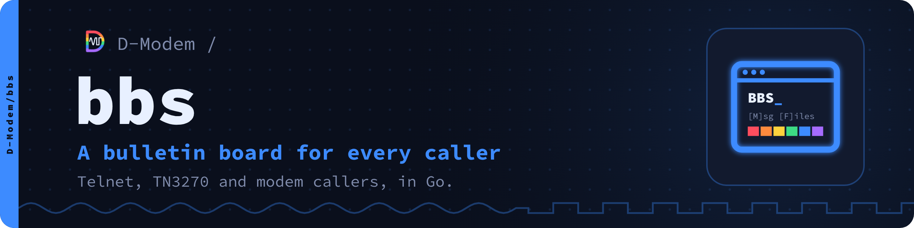

# bbs

A bulletin board system in Go for telnet, SSH, TN3270 and modem callers.

One telnet port serves every kind of terminal: a TN3270 client (x3270,
c3270, wc3270, Vista, PCOMM) gets full 3270 screens with PF keys, through
[go3270](https://github.com/D-Modem/go3270); any other client gets a text
BBS with ANSI colour where the terminal has it. Modem callers come in
through the D-Modem suite: [app_dmodem](https://github.com/D-Modem/D-Modem)
straight from Asterisk, or [modemmenu](https://github.com/D-Modem/menu)
after its login.

```
D-Modem BBS
Node 2, modem at 26400 bit/s

Name (or NEW): alice
Password: **********

Welcome, alice.

Main menu
  [M] Message areas         [E] E-mail (1 new)
  [W] Who's online          [U] User list
  [P] Your profile          [I] System info
  [C] Chat                  [S] Page the sysop
  [G] Goodbye
```

- Message areas, private mail, chat, paging and doors (DOS doors in dosemu2, or Linux programs)
- File areas with X/Y/ZMODEM, Kermit, IND$FILE and FTP
- Networks: FidoNet and other FTNs, QWK, NNTP newsgroups, IRC (and linking into an IRC network as a TS6 hub server), AIM and ICQ, and MRC
- Terminals: ANSI, VT, PETSCII, RIPscrip, sixel and 3270 graphics
- On the web: a forum, image boards, a web terminal and an HTTP API
- SQLite, PostgreSQL, MySQL or MariaDB

The full list is on the [wiki's home page](https://github.com/D-Modem/bbs/wiki/Home).

## Quick start

Go 1.24 or later:

```
make                                    # or: go build ./cmd/bbs
bbs -config /etc/bbs/bbs.conf config    # the configuration screens (begun from the sample)
bbs -config /etc/bbs/bbs.conf check     # the configuration, its warnings
bbs -config /etc/bbs/bbs.conf init      # the database, with two areas
bbs -config /etc/bbs/bbs.conf user add sysop -sysop
bbs -config /etc/bbs/bbs.conf serve
```

[bbs.conf.sample](bbs.conf.sample) has every option, and
[bbs.service.sample](bbs.service.sample) runs it under systemd.

## Documentation

The documentation is also a website, [d-modem.github.io/bbs](https://d-modem.github.io/bbs/), with reference pages made from the code.

The documentation is in the [wiki](https://github.com/D-Modem/bbs/wiki/): start with [Building](https://github.com/D-Modem/bbs/wiki/Building),
[Running](https://github.com/D-Modem/bbs/wiki/Running) and [Configuration](https://github.com/D-Modem/bbs/wiki/Configuration). Its pages are
kept in [`docs/wiki`](docs/wiki), where they are edited; the
[Wiki](.github/workflows/wiki.yml) workflow publishes them. Future work is
in [TODO.md](TODO.md).

## The D-Modem suite

| Repository | What it is |
| --- | --- |
| [D-Modem](https://github.com/D-Modem/D-Modem) | The open V.92 softmodem: dmodemd, libdmodem and the Asterisk, FreeSWITCH and ARI modules |
| [app](https://github.com/D-Modem/app) | The D-Modem app for Android and iOS: a dial-up modem on a SIP call |
| [hardware](https://github.com/D-Modem/hardware) | pico-serial: RP2040 serial adapters and phone-line USB sticks |
| [menu](https://github.com/D-Modem/menu) | modemmenu: the login and menu dial-up callers reach |
| [bbs](https://github.com/D-Modem/bbs) | A bulletin board for telnet, SSH, TN3270 and modem callers |
| [go3270](https://github.com/D-Modem/go3270) | A Go library for 3270 terminal servers, used by bbs |
| [brand](https://github.com/D-Modem/brand) | Logos, colours, type and the naming guide |

## Licence

AGPL-3.0-only ([LICENSE](LICENSE)), or a commercial licence from the D-Modem Authors ([COMMERCIAL-LICENSE.md](COMMERCIAL-LICENSE.md)). Contributions come with a contributor agreement ([CONTRIBUTING.md](CONTRIBUTING.md)).
