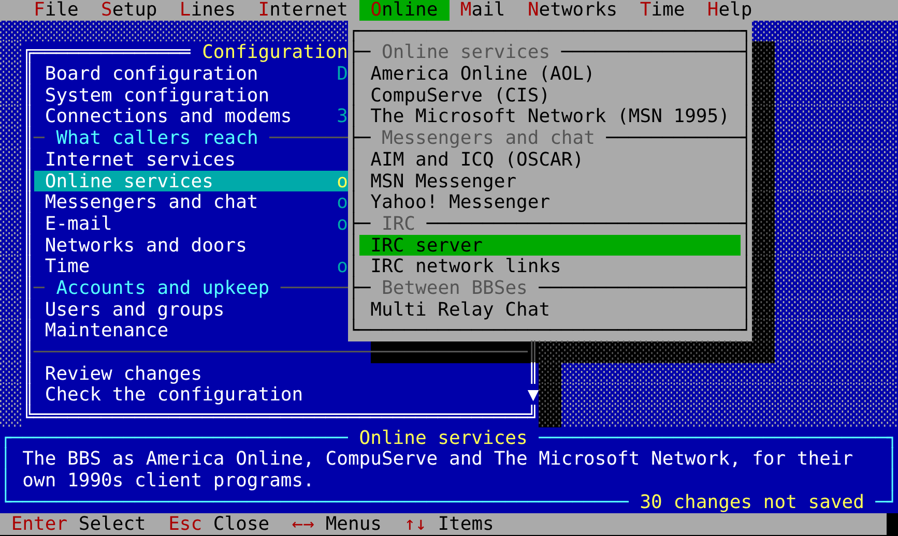

The BBS reads its settings from one file, `bbs.conf`. This page tells
you the layout of the file, how to edit it in the configuration screens,
and which settings can change while callers are on.
[bbs.conf.sample](https://github.com/D-Modem/bbs/blob/HEAD/bbs.conf.sample)
has all options with comments. The
[Configuration reference](Configuration-Reference) lists all of them,
section by section.

## Listeners

`[general]` holds the settings for the full system (name, database, log,
banner, message of the day, timeouts and limits). Each `[listen NAME]`
section is a port or unix socket on which callers connect. Its `type`
tells the type of caller to expect:

| `type` | What comes in |
|---|---|
| `telnet` | a telnet client. With `tn3270 = yes` (the default), 3270s get 3270 screens |
| `raw` | bytes as they come: the `mode = tcp` of app_dmodem, a modemmenu `tcp` or `unix` item |
| `rlogin` | RFC 1282, as the `rlogin` items of modemmenu use it |
| `ssh` | SSH: the text BBS, with login by password or key ([SSH](SSH)) |

`address` is `host:port`, or a path for a unix socket (with
`socket_mode` and `socket_group`). All listeners except `ssh` can read a
session header first (`header = yes`). With `trust_user = yes`, the
listener accepts the caller as already logged in. Refer to
[Modem callers](Modem-Callers). (An `ssh` listener logs in its callers
itself.) `petscii` and `rip` tell if callers can be Commodores or
RIPscrip terminals (refer to [PETSCII and RIP](PETSCII-and-RIP)). `vt`
tells if the BBS asks terminals what they are (refer to
[Terminal identification](Terminal-Identification)).

## The sections

| Section | What it sets | Page |
|---|---|---|
| `[general]` | the system: name, sysop, database, log, banner, message of the day, logo, new users, limits, timeouts, the directory and limits of the file areas | here, [Security](Security) |
| `[listen NAME]` | a port or socket on which callers connect | here, [Modem callers](Modem-Callers), [TN3270](TN3270) |
| `[ftp]` | the FTP server for the file areas | [Files and FTP](Files-and-FTP) |
| `[news]`, `[nntp]`, `[peer NAME]` | newsgroups, the NNTP server, news peers | [Newsgroups and NNTP](Newsgroups-and-NNTP) |
| `[fido]`, `[binkp]`, `[link NAME]` | FidoNet: our address, the binkp mailer, links | [FidoNet](FidoNet) |
| `qwk_id` (in `[general]`), `[qwknet NAME]` | the name of QWK packets. The QWK networks of which this BBS is a node | [Offline mail](Offline-Mail) |
| `[door NAME]` | a door program | [Doors](Doors) |
| `screens_dir` (in `[general]`), `[menu NAME]`, `[strings]` | the screens, menus and prompts of the sysop | [Customization](Customization) |
| `scripts_dir` (in `[general]`) | the JavaScript of the sysop | [Scripting](Scripting) |
| `[security]` | deny lists, bans, the hack log | [Security](Security) |
| `[event NAME]` | scheduled programs | [Sysop tools](Sysop-Tools) |
| `[finger]`, `[gopher]`, `[gemini]` | the finger, gopher and Gemini servers | [Finger, gopher and Gemini](Finger-and-Gopher) |
| `[irc]` | the IRC server for the chat rooms | [IRC](IRC) |
| `[mrc]` | Multi Relay Chat | [MRC](MRC) |
| `database` (in `[general]`) | the SQLite file, or a PostgreSQL, MySQL or MariaDB server | [Databases](Databases) |
| `[level N]`, `new_user_level`, `validated_level` (in `[general]`) | access levels | [Access levels](Access-Levels) |
| `[http]` | the HTTP API, its WebSockets, the web forum, the web terminal and metrics | [HTTP API](HTTP-API), [Web forum](Web-Forum) |
| `[chan]`, `chan` (in `[http]`) | the image boards | [Image boards](Image-Boards) |
| `page_command` (in `[general]`) | tells the sysop about a page when the sysop is not on | [Chat and paging](Chat-and-Paging) |
| `geoip`, `geoip_credit`, `phone_country`, `geoip_users`, `geoip_prefill` (in `[general]`) | the locations of callers: a country database for addresses, the home country of caller IDs. Users who share their location with the sysops. The locations of new users filled in | [Modem callers](Modem-Callers#where-callers-are), [Web forum](Web-Forum#flags) |

`bbs check` reads the file and reports what it found. It gives a warning
about risks, for example a password that can go across the network in
clear text, a socket that trusts all processes that connect, or a link
without a password.

## Editing it: the configuration screens

`bbs -config /etc/bbs/bbs.conf config` opens the setup screens on your
terminal. Use them to edit the file and the accounts, while the BBS runs
or not. The same screens are in the [sysop tools](Sysop-Tools) (`F`,
Configuration). On an ANSI terminal, they look like the BBS setup
programs of the 1990s:

- A menu bar of pull-down menus, and a shaded blue desk.
- Each menu is a window over the menu from which you opened it.
- The help of the line is in a box below.
- You change values in boxes that pop up.

On a 3270, they use PF keys. On a terminal with neither, they become
numbered lines.

| Menu | What is in it |
|---|---|
| Board configuration | the name of the BBS, the name of the sysop, the location, postal address, dial-in numbers and internet addresses. The banner, message of the day, goodbye, logo. Menus and prompts |
| System configuration | the user and group that the BBS runs as. The database and log. The location of files and their maximum size. Deny lists, the hack log, bans. Scheduled events. All sections of the file as they are |
| Connections and modems | modem lines and all listeners. Callers at one time, logins, time-outs, lock-outs. Passwords by the auth socket of modemmenu ([Modem callers](Modem-Callers#the-same-password-for-telnet-ssh-and-the-web)). The caller ID country and GeoIP |
| Internet services | telnet, TN3270, SSH and RLogin listeners. Finger, gopher, Gemini, FTP, news, the web (API, forum, image boards) |
| Online services | [AOL](AOL), [CompuServe](CompuServe) (its listeners) and [The Microsoft Network](MSN-Classic) (its TCP host and dial-in listeners) |
| Messengers and chat | [AIM and ICQ](AIM-and-ICQ), [MSN Messenger](MSN-Messenger), [Yahoo! Messenger](Yahoo-Messenger), the [IRC](IRC) server, [IRC network links](IRC-Linking) and their peers, [MRC](MRC) |
| E-mail | [`[mail]`](E-mail), the smarthost, POP3, IMAP, SMTP submission, MX and LMTP |
| Networks and doors | [FidoNet](FidoNet) and binkp, QWK networks, doors |
| Time | the clock and its sources, and the NTP, NTS-KE and PTP servers ([Time](Time)) |
| Users and groups | the accounts (level, flags, sysop, locked, a new password. New accounts. Deleted accounts) and the access levels |
| Maintenance | disk space. The quantity of messages that message areas keep, and the removal of old messages. The archive of the image boards. Backups: one now, the backups made, `[backup]` ([Backups](Backups)) |

The pull-down menus of the menu bar (`/`, F12, or Alt and the red
letter of the menu) go directly to these menus from all locations: File
(review, check, save, quit), Setup, Lines, Internet, Online (the online
services and the messengers), Mail, Networks, Time and Help.

modemmenu checks system passwords (PAM, LDAP). It logs in callers and
gives them to the BBS (refer to [Modem callers](Modem-Callers)). For how
to run the BBS as its own user (Run as user in System configuration),
refer to [Running](Running#running-as-a-user-of-its-own).

| Key | What it does |
|---|---|
| arrows, PgUp, PgDn, Home, End | move (a letter goes to the next line that starts with it) |
| Enter | opens a menu, changes a value (typed in a box that pops up, or selected from a list of its values), does an action |
| Space | changes a yes/no value, or goes to the next value (for a list: opens it. In a list with more than one selection: selects or clears one item) |
| Esc, left arrow | goes back one window |
| `/`, F12, Alt+letter | the pull-down menus of the menu bar (arrows between them, Enter to go) |
| F1 or `?` | the full help for the line (from bbs.conf.sample) |
| F9 | quits without a save (after a yes, if you changed something) |
| F10 | saves and exits |
| `A`, `D` | adds one item (a listener, a door, a user ...), deletes it |
| Ctrl-L | draws the screen again |

### Values picked from what there is

You select most settings from a list (marked `↕`). You do not type
them. The screens make the list from the items that the file and the
machine have, with a word adjacent to each item:

| Setting | Offered |
|---|---|
| a certificate (`tls_cert`, `cert_file`) | `acme` and each `acme:NAME` (with its names), `ca` where the CA of the BBS can sign it, and the certificate files that other servers use |
| its key (`tls_key`, `key_file`) | the key for the selected certificate (from a different server, or adjacent to it on disk), and the other keys that the file names. The screens do not ask for it with `acme` or `ca` |
| an address on which a server listens | all addresses, this machine only, and each IP of this machine, at the port that it has (or the usual port). If a different server uses an address, the screens mark it *taken by* |
| `[dns]` `answer` and `*_answer` | the IPs on which the services listen, and the IPs of this machine |
| `[dnsrecord]` `type`, `value` (DNS for callers, DNS records) | the record types, each with the format of its value. The address of an A or AAAA record from the addresses of this machine and of the services |
| `[dns]` `primary`, `backup` | the servers of this host, and the well-known public servers |
| `[dns]` `services`, `[feeds]` `catalog`, `[time]` `servers`, `[mx]` `dnsbl`, the `areas` of gopher and Gemini | more than one at a time (Space on each) |
| levels (of new users, of validated users, of a user, `[mrc]` and `[menu]` `require`) | the `[level N]`s, with their names |
| a menu item (Add a menu item on the page of a menu) | the actions of the BBS, each door, the other menus, the screens and scripts, the areas, each with a label to start from |
| `[menu]` `screen` | the display files in `screens_dir` |
| `[link]` `aka` | the addresses of `[fido]` |
| `[feed]` `group`, `area` | the groups of the catalogue and of the other feeds. The message areas |
| the user and groups that the BBS runs as | the accounts and groups of this machine |
| the CA, DNS provider, challenge and key type of ACME. The log. TLS modes. Outbound mail. The other settings with a fixed set of values | those values, with the function of each |

If the values of a list are only suggestions, the list ends with *Type
another value*. On a 3270, you can always type over the value. F1 lists
the values with their notes. On a 3270, `S` adjacent to such a line
opens the list. On a terminal without ANSI, its number opens the list,
with a number for each value.

In a box where you type a value, the arrows, Home and End move. Ctrl-U
clears the value. Enter keeps it. Esc does not change the value. The
screens send one changed cell at a time. Thus, a movement of the bar
uses only a few bytes for a modem caller. A terminal without UTF-8 gets
the lines and shading of code page 437.

On a 3270, type `S` adjacent to a menu to open it. Type over values and
send them with Enter. PF1 is help, PF3 goes back, and PF9 and PF10
operate as F9 and F10. On a terminal without ANSI, type the number of a
line to open or change it. Type `S` to save and exit, or `X` to leave
without a save.

Nothing changes until you save. A changed line has the mark `*`, and the
help box counts the changes that are not saved. Review changes on the
main menu lists all of them. Check the configuration reads the file as
the BBS reads it.

When you save, the screens first check the file. They do not save it if
the BBS cannot start with it, or if a different person changed it after
the screens read it. Then they write the full file. They keep its
permissions and owner, and keep the previous version as `bbs.conf.bak`.
All comments stay where they were. A new key goes below the commented
example of it from the sample. After that, the screens make the changes
to accounts and areas. From the menu of the sysop, settings that can
change while callers are on apply immediately. The screen tells which
settings wait for a restart. If there is no file yet, the screens offer
to start one from the sample.

Scripts can read and change one key at a time:

    bbs -config /etc/bbs/bbs.conf config get general name
    bbs -config /etc/bbs/bbs.conf config get "listen telnet"
    bbs -config /etc/bbs/bbs.conf config set "listen ssh" address :2222
    bbs -config /etc/bbs/bbs.conf config unset general motd

The command checks each change as the BBS reads it, before it writes the
change. Then it prints what changed and when the change applies.

## Changing it while callers are on

`systemctl reload bbs` (`ExecReload` in bbs.service.sample, which sends
SIGHUP) makes the BBS read the file again. If the BBS cannot start with
the new file, nothing changes, and the log gives the reason. If it can,
the keys below apply immediately. The log lists the other changes, which
wait for a restart:

| Section | Keys that change at once |
|---|---|
| `[general]` | `name`, `sysop`, `location`, `postal_address`, `phone`, `addresses`, `banner`, `banner_file`, `motd`, `motd_file`, `goodbye`, `new_users`, `max_nodes`, `attempts`, `fail_delay`, `login_timeout`, `idle_timeout`, `throttle_failures`, `throttle_time`, `page_command`, `qwk_id`, `geoip`, `geoip_credit`, `geoip_credit_url`, `phone_country`, `geoip_users`, `geoip_prefill`, `new_user_level`, `validated_level` |
| `[level N]` | all, and the levels that you add or remove |
| `[backup]` | all ([Backups](Backups)) |
| `[menu NAME]`, `[strings]` | all (a caller in a menu keeps the old menu until the caller leaves it) |
| `[chan]` | all except `dir` |
| `[http]` | `forum_guests`, `forum_theme`, `forum_flags` |

The BBS configures listeners, servers (FTP, NNTP, IRC, the HTTP API and
other servers), networks, doors, the database and the log when it
starts. Thus, changes to them wait for a restart. The same applies to
settings that the session of a caller took at its start, for example its
idle timeout. The Configuration screen of the sysop applies the file
itself when it writes it. It tells which changes applied and which
wait.

The `ProtectSystem=strict` of bbs.service.sample stops the service from
writes to /etc. For the Configuration screen inside the BBS to save, give
the service `ReadWritePaths=/etc/bbs`, and give the file to the bbs
user. `bbs
config` run as root operates in both cases.

> **WARNING: IF THE BBS CAN WRITE ITS CONFIGURATION, ALL SYSOPS CAN MAKE
> IT RUN COMMANDS.** Doors, events and `page_command` run commands. If you
> do not trust all sysops as much as root, keep the file read-only.

**See also:** [Modem callers](Modem-Callers), [TN3270](TN3270), [Security](Security), [Sysop tools](Sysop-Tools)
