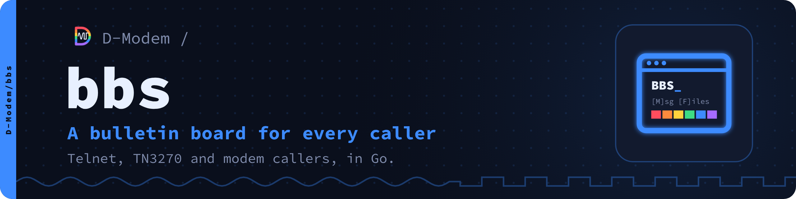

bbs is a bulletin board system in Go for telnet, SSH, TN3270 and modem
callers. It is part of the [D-Modem suite](https://github.com/D-Modem/D-Modem).
This is its documentation: how to configure it, how to run it, and how to
use all its functions.

One telnet port serves all types of terminal. A TN3270 client (x3270,
c3270, wc3270, Vista, PCOMM) gets full 3270 screens with PF keys, through
[go3270](https://github.com/D-Modem/go3270). All other clients get a text
BBS, with ANSI colour if the terminal has it. Modem callers connect
through the D-Modem suite: through [app_dmodem](https://github.com/D-Modem/D-Modem)
directly from Asterisk, or through [modemmenu](https://github.com/D-Modem/menu)
after its login.

```
D-Modem BBS
Node 2, modem at 26400 bit/s

Name (or NEW): alice
Password: **********

Welcome, alice.

Main menu
  [M] Message areas         [E] E-mail (1 new)
  [W] Who's online          [U] User list
  [P] Your profile          [I] System info
  [C] Chat                  [S] Page the sysop
  [G] Goodbye
```

## Start here

| If you want to | Read |
|---|---|
| Try it in a few minutes | [Building](Building), then [Running](Running) |
| Configure a board for real use | [Running](Running), [Configuration](Configuration), [Databases](Databases), [Backups](Backups) |
| Manage a board that runs | [Administration](Administration), [Sysop tools](Sysop-Tools), [Access levels](Access-Levels) |
| Give it your own appearance | [Customization](Customization), [Scripting](Scripting) |
| Take calls by modem | [Modem callers](Modem-Callers) |
| Join FidoNet, QWK networks or Usenet | [FidoNet](FidoNet), [Offline mail](Offline-Mail#qwk-networks), [Newsgroups and NNTP](Newsgroups-and-NNTP) |
| Give users e-mail addresses | [E-mail](E-mail) |
| Put the board on the web | [Web forum](Web-Forum), [Image boards](Image-Boards), [HTTP API](HTTP-API) |
| Work on the code | [Development](Development) |

The [Configuration reference](Configuration-Reference) lists all the
settings. The build makes it from `bbs.conf.sample`.

## What it does

**For callers**

- [Message areas](Message-Areas) with new scans, search, threads, votes
  and polls, written in a [full-screen editor](Writing-Messages).
- Private mail, chat rooms, node messages and [pages to the sysop](Chat-and-Paging).
- Who's online (with the route of each caller), the user list, the last
  callers, feedback to the sysop, and a profile for each caller.
- [File areas](Files-and-FTP) with X/Y/ZMODEM, Kermit and IND$FILE
  [transfers](File-Transfers), and an FTP (FTPS) server.
- [Offline mail](Offline-Mail): QWK packets of new messages, and REP packets
  of replies.
- [Doors](Doors): DOS door games in dosemu2, Linux programs, and door
  networks such as BBSLink and DoorParty.

**Terminals**

- [TN3270](TN3270) screens with PF keys, and 3270 graphics if the
  emulator has them.
- [SSH](SSH), with passwords or keys.
- [Commodore 64s in PETSCII and RIPscrip terminals](PETSCII-and-RIP).
- [VT terminals](Terminal-Identification), with DEC line drawing, monochrome
  and VT52 support.
- [Sixel graphics](Sixel-Graphics) for the logo and pictures.

**Networks**

- [FidoNet](FidoNet) and other FTN networks: echomail, netmail, file
  echoes, AreaFix and a built-in binkp mailer.
- [E-mail](E-mail): an address for each user. Users read their BBS mail
  over IMAP and POP3, and send it over SMTP, to and from the internet.
- [Newsgroups](Newsgroups-and-NNTP) served by NNTP and exchanged with other
  news servers.
- [IRC](IRC), where the chat rooms are channels. [AIM and ICQ](AIM-and-ICQ)
  for AIM and ICQ clients on the same chat. [MSN Messenger](MSN-Messenger)
  for MSN clients. [Yahoo! Messenger](Yahoo-Messenger) for Yahoo clients. [MRC](MRC), the chat
  network shared with other BBSes.
- [News, weather and quotes](News-Weather-and-Quotes): news feeds as read-only
  areas, the weather of each caller, and stock quotes from IEX.
- [Finger, gopher and Gemini](Finger-and-Gopher).
- [Time](Time): NTP, NTS and PTP. The BBS follows time servers and serves
  time.

**On the web**

- [A web forum](Web-Forum) of the message areas, in the style of classic
  forum software (Invision Power Board, vBulletin, phpBB and many more).
- [Image boards](Image-Boards) in the style of kusaba x and 4chan, also
  shown on the terminals.
- [A web terminal](HTTP-API#the-web-terminal) and an [HTTP API](HTTP-API)
  with REST, server-sent events and WebSockets.

**For the sysop**

- New users who sign up themselves (or not, with `new_users = no`), and
  [access levels](Access-Levels) with flags, daily limits and validation.
- [Customization](Customization) with ANSI art, 3270 screens, menus and
  prompts, and [scripting](Scripting) in JavaScript.
- [SQLite, PostgreSQL, MySQL or MariaDB](Databases), with `bbs db copy`
  between them.
- [Backups](Backups) while callers are on, [security](Security)
  settings to keep callers out, and [certificates](Certificates) from
  Let's Encrypt and other ACME CAs, which the BBS gets and renews.

## All pages

| Page | What it covers |
|---|---|
| [Building](Building) | Go, the go3270 fork, `make` |
| [Running](Running) | the first start, systemd, the BBS as its own user |
| [Administration](Administration) | the `bbs` command: users, areas, files, mail exchange |
| [Sysop tools](Sysop-Tools) | the menu of the sysop inside the BBS, and scheduled events |
| [Configuration](Configuration) | `bbs.conf`: its sections, listeners and configuration screens |
| [Configuration reference](Configuration-Reference) | all sections and keys |
| [Databases](Databases) | SQLite, PostgreSQL, MySQL and MariaDB, and how to move between them |
| [Backups](Backups) | how to make backups, and how to restore them |
| [Customization](Customization) | screens (ANSI art, 3270), menus, prompts |
| [Scripting](Scripting) | the screens of the sysop in JavaScript, on all terminals |
| [Access levels](Access-Levels) | levels, flags, requirements, daily limits, validation |
| [SSH](SSH) | the SSH listener, keys, host keys |
| [Modem callers](Modem-Callers) | app_dmodem and modemmenu, and the locations of callers |
| [TN3270](TN3270) | 3270 terminals, PF keys, 3270 graphics |
| [Sixel graphics](Sixel-Graphics) | the logo and pictures on sixel terminals |
| [PETSCII and RIP](PETSCII-and-RIP) | Commodore 64s and 128s; RIPscrip graphics and buttons |
| [Terminal identification](Terminal-Identification) | how the BBS recognises VT terminals: DEC graphics, monochrome, VT52 |
| [Message areas](Message-Areas) | how to read, new scans, search, votes and polls |
| [Writing messages](Writing-Messages) | the full-screen editor, the line editor, the 3270 editor |
| [Offline mail](Offline-Mail) | QWK packets, REP replies, QWK networks |
| [Files and FTP](Files-and-FTP) | file areas, the FTP (FTPS) server |
| [File transfers](File-Transfers) | X/Y/ZMODEM, Kermit, IND$FILE |
| [Doors](Doors) | DOS doors in dosemu2 (Docker), Linux doors, doors on other systems |
| [E-mail](E-mail) | addresses, IMAP, POP3, SMTP, the MX, a smarthost, DNS |
| [Newsgroups and NNTP](Newsgroups-and-NNTP) | the NNTP server, news peers |
| [FidoNet](FidoNet) | echomail, netmail, binkp, file echoes, AreaFix, nodelists |
| [Chat and paging](Chat-and-Paging) | chat rooms, node messages, pages to the sysop |
| [IRC](IRC) | the IRC server, with the chat rooms as channels |
| [AIM and ICQ](AIM-and-ICQ) | the OSCAR server: AIM and ICQ clients, buddies, IMs and chat rooms |
| [IRC server linking](IRC-Linking) | The BBS as a hub server on an IRC network (TS6 or P10): all users are on that network |
| [AOL clients](AOL) | a host for the clients of AOL (3.0, 4.0): sign-on with BBS accounts |
| [MSN Messenger](MSN-Messenger) | the MSN server: MSN Messenger 1.0 to 7.5, contacts and IMs |
| [MSN Classic](MSN-Classic) | The Microsoft Network for the client of Windows 95: sign-in, the areas as Categories, bulletin boards |
| [Yahoo! Messenger](Yahoo-Messenger) | the Yahoo server: YMSG 9 to 16, buddies, IMs, chat rooms and conferences |
| [MRC](MRC) | Multi Relay Chat: chat rooms shared with other BBSes |
| [News, weather and quotes](News-Weather-and-Quotes) | news feeds, NWS and Open-Meteo weather, USGS earthquakes, IEX quotes |
| [Finger, gopher and Gemini](Finger-and-Gopher) | the users who are on, and the BBS in gopherspace and Geminispace |
| [Time](Time) | NTP, NTS and PTP: the clock follows time servers, and the BBS serves time |
| [Web forum](Web-Forum) | the message areas as a web forum |
| [Image boards](Image-Boards) | anonymous image boards, in the style of kusaba x and 4chan |
| [HTTP API](HTTP-API) | REST, events, WebSockets in JSON and protobuf, tokens, metrics |
| [Security](Security) | the protection that the BBS gives, and how |
| [Certificates](Certificates) | the ACME client: Let's Encrypt and ZeroSSL certificates for all TLS servers, with renewal |
| [Development](Development) | the layout of the source, the shared screens, the tests |

## More

- The wiki is also a website: [d-modem.github.io/bbs](https://d-modem.github.io/bbs/).
- The list of planned work is in [TODO.md](https://github.com/D-Modem/bbs/blob/HEAD/TODO.md).
- The [README](https://github.com/D-Modem/bbs#the-d-modem-suite) lists the
  other parts of the suite.
